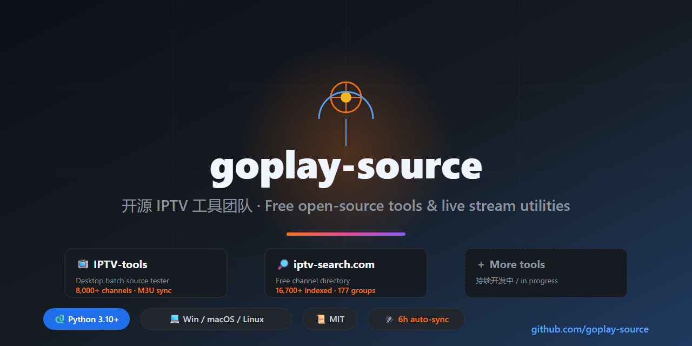

<!-- SEO keywords: goplay-source, IPTV-tools, iptv-search, free iptv, m3u, m3u8, iptv 工具, iptv 测试, iptv 频道 -->

  

# 🛰️ goplay-source

  <b>开源 IPTV 工具团队 · 免费频道目录维护方</b>

## 📦 我们维护什么

| 项目 | 说明 | 规模 |
|---|---|---|
| [**IPTV-tools**](https://github.com/goplay-source/IPTV-tools) | 桌面批量直播源测试工具 | 8,000+ 频道 M3U 自动同步 |
| [**iptv-search.com**](https://iptv-search.com) | 免费在线频道目录 + 搜索引擎 | 16,700+ 索引 / 177 分组 |

## 📊 数据规模

| 指标 | 数值 |
|---|---|
| 频道索引 | 16,753 |
| 国家分组 | 177 |
| 每日可播样本 | 20 |
| 自动同步 | 每 6 小时 |

## 🔗 直接跳转

- [频道搜索 →](https://iptv-search.com/search?type=channel&q=CCTV1)（预填示例）
- [llms.txt →](https://iptv-search.com/llms.txt)（LLM 友好摘要）
- [站点地图 →](https://iptv-search.com/sitemap.xml)

⭐ 喜欢就 star 一下，后续所有开源仓库都会挂在这个账号下。
